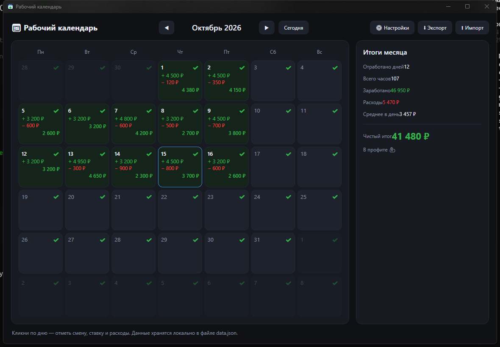

# Рабочий календарь 📅💰

Небольшое десктопное приложение для учёта рабочих смен и расходов. Помогает понимать, **сколько ты реально заработал и не ушёл ли в минус**.


## Скачать

Готовый `WorkCalendar.exe` (Windows x64) — в разделе [Releases](../../releases/latest).

Это один файл, установка не нужна. Нужен установленный
[.NET Desktop Runtime 10](https://dotnet.microsoft.com/download/dotnet/10.0)
(либо собери сам из исходников — см. «Сборка и запуск» ниже).

## Возможности

- **Календарь на месяц** (Пн–Вс), текущий день подсвечен.
- **Отметка рабочих дней**: клик по дню открывает редактор.
- **Оплата за час**: указываешь начало и конец смены — часы считаются автоматически.
- **Оплата за смену**: фиксированная сумма за день.
- **Расходы за день**: список с названием и суммой (обед, проезд и т.п.).
- **Итог по дню**: заработано / расходы / чистая прибыль.
- **Итоги месяца**: отработано дней, всего часов, заработано, расходы, среднее в день и чистый итог.
- **Настройки**: валюта, ставки и время смены по умолчанию.
- **Экспорт / импорт** всех данных в JSON (бэкап).
- Тёмная аккуратная тема.

## Скриншот



## Технологии

- **C# / WPF**
- **.NET 10** (`net10.0-windows`)
- Данные хранятся локально в JSON

## Сборка и запуск

Нужен [.NET SDK 10](https://dotnet.microsoft.com/download).

```bash
# из папки WorkCalendar
dotnet run -c Release
```

Сборка одиночного exe:

```bash
dotnet publish -c Release -r win-x64 --self-contained false ^
  -p:PublishSingleFile=true -p:IncludeNativeLibrariesForSelfExtract=true -o ..\dist
```

Готовый файл появится в `dist/WorkCalendar.exe`.

## Где хранятся данные

```
%APPDATA%\WorkCalendar\data.json
```

Файл создаётся автоматически. Для переноса на другой компьютер используй кнопки **Экспорт / Импорт**.

## Структура проекта

```
WorkCalendar/
├── App.xaml            # общие ресурсы и стили темы
├── MainWindow.xaml     # главное окно: календарь + итоги месяца
├── DayEditorWindow.xaml# окно редактирования дня
├── Models.cs           # модели данных (день, расход, настройки)
├── Store.cs            # загрузка/сохранение и экспорт/импорт JSON
├── icon.ico            # иконка приложения
└── icon-512.png        # аватарка/иконка в большом размере
```

## Лицензия

[MIT](LICENSE) — делай что хочешь 🙂
